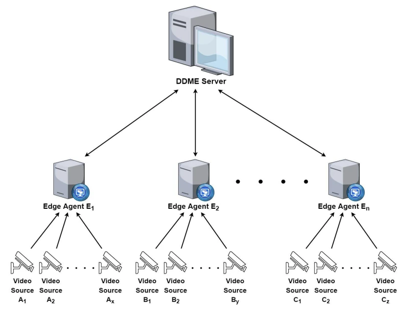
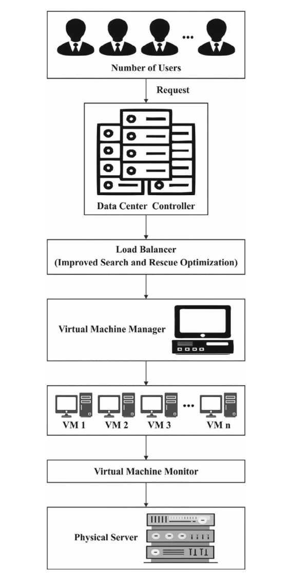

# Edge Computing for Video Processing

Research on distributing video-processing workloads across edge servers. Processing video close to its source can reduce dependence on a central cloud service, but uneven workloads can leave some servers overloaded while others have spare capacity. This work examines how processing tasks can be redistributed across available resources.

This repository brings together an undergraduate thesis on a Dynamic Decision-Making Engine (DDME) and a related journal publication on an optimization-based load-balancing scheme. The two methods address a shared problem through different approaches.

## Thesis: A Cost-effective Edge Computing Framework for Video Processing

**Authors:** Apurva Umredkar and Sidharth Dinesh  
**Institution:** Visvesvaraya National Institute of Technology, Nagpur  
**Advisor:** Ashwin G. Kothari

The thesis develops a DDME framework that coordinates video-processing workloads across edge agents. A central decision-making server monitors video-buffer utilization, identifies overloaded and underused agents, and directs video frames toward available processing capacity.



The work includes:

- A coordination framework connecting a decision-making server, edge agents, and video sources
- Load assessment based on video-buffer utilization
- Redistribution of video frames between agents with different workloads
- Experimental comparisons of processing latency under different workload conditions

## Related publication: ISROLBS-ECE

**Improved search and rescue optimization based load balancing scheme of CCTV footage on edge computing environment**

Prasanna Deshpande, Sidharth Dinesh, Apurva Umredkar, and Ashwin G. Kothari  
*Concurrency and Computation: Practice and Experience*, 35(5), e7556, 2023  
**DOI:** [10.1002/cpe.7556](https://doi.org/10.1002/cpe.7556)

The paper presents an improved search-and-rescue optimization approach to distributing CCTV-processing workloads. Its load-balancing architecture connects incoming requests, a controller, a virtual-machine manager, and the available computing resources.



“Search and rescue” names the optimization method. It does not mean the paper evaluates an emergency-response application.

## Relationship between the thesis and paper

| Work | Main approach |
| --- | --- |
| DDME thesis | Coordinates edge agents using buffer utilization and workload redistribution |
| ISROLBS-ECE paper | Applies an improved search-and-rescue optimization method to load balancing |

Both concern the allocation of video-processing work across computing resources. DDME and ISROLBS-ECE are distinct methods and should not be treated as interchangeable names for one implementation.

## Research materials

The thesis and paper provide the framework descriptions and experimental discussion. A complete implementation, dependency specification, and experiment scripts are not included in the available archive, so this repository serves as a research overview rather than an executable reproduction package.

The diagrams above show the DDME and ISROLBS-ECE architectures from their respective research documents. Publication details and access options are available through the DOI link.

## Citation

```bibtex
@article{deshpande2023edge,
  author  = {Deshpande, Prasanna and Dinesh, Sidharth and
             Umredkar, Apurva and Kothari, Ashwin G.},
  title   = {Improved search and rescue optimization based load balancing
             scheme of CCTV footage on edge computing environment},
  journal = {Concurrency and Computation: Practice and Experience},
  year    = {2023},
  volume  = {35},
  number  = {5},
  pages   = {e7556},
  doi     = {10.1002/cpe.7556}
}
```

## Related work

[Research background and other work](https://sidharth-dinesh.github.io/) · [GitHub profile](https://github.com/Sidharth-Dinesh)
